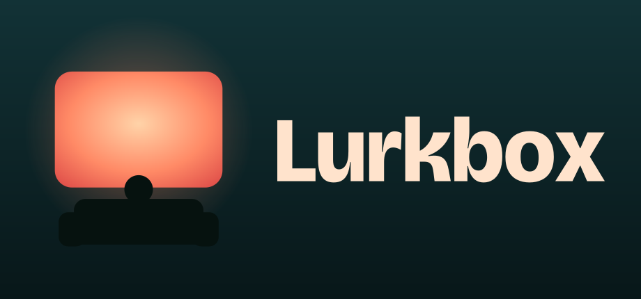

**Lurkbox** is a couch and controller client for Twitch. It's made for SteamOS Game Mode, with Android TV, tablets and phones planned next.

- **Built for the TV:** big type, D-pad and controller navigation, themes, and no keyboard needed.
- **Follows the stream for you:** your followed channels, live and offline, with automatic raid following, catch-up to live, rewind, and scrubbing through past broadcasts.
- **Chat as it looks on twitch.tv:** Twitch, 7TV, BetterTTV and FrankerFaceZ emotes, badges and colour emoji. Channel points, predictions and polls work from the controller.
- **Plays well with Floater:** keeps playing in the background, so the [Floater](https://github.com/jancard/decky-floater) Decky plugin can float it over a game.

### Projects

| Repository | What it is |
|---|---|
| [lurkbox](https://github.com/lurkbox/lurkbox) | The app: desktop (AppImage, with Flatpak planned) now, Android later |
| [decky-lurkbox](https://github.com/lurkbox/decky-lurkbox) | A [Decky Loader](https://github.com/SteamDeckHomebrew/decky-loader) plugin that sends go-live notifications for channels you follow, even mid-game |

> **AI disclosure:** Lurkbox is vibe-coded. Claude (Anthropic's AI coding assistant) wrote nearly all of the code, artwork and docs, directed and tested by [aronwk-aaron](https://github.com/aronwk-aaron). Human review has been limited, so expect rough edges.

Lurkbox is not affiliated with or endorsed by Twitch. Licensed under GPL-3.0.
